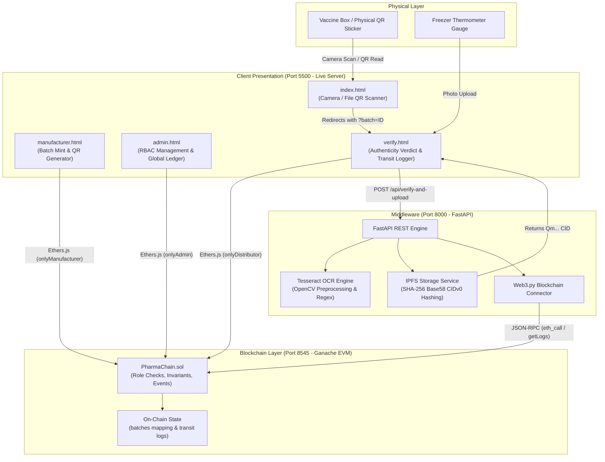
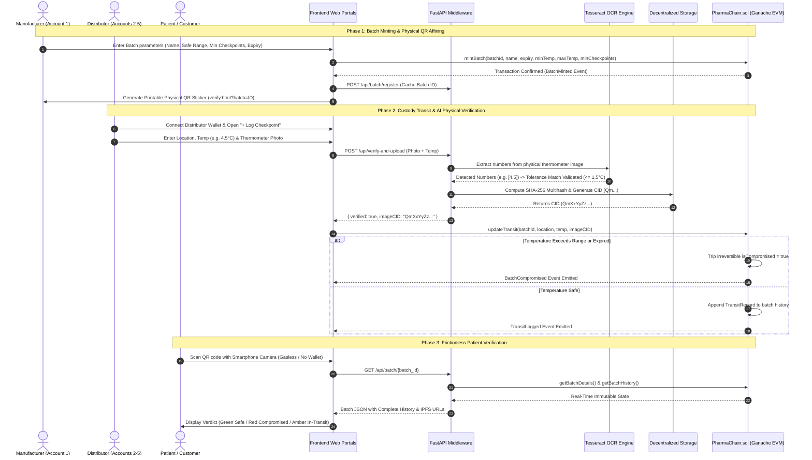
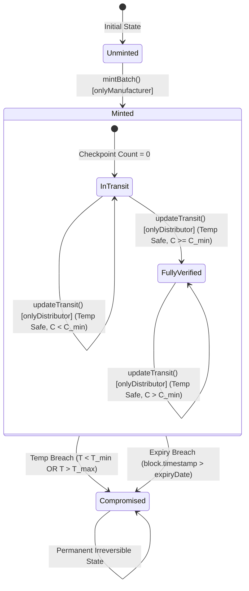

# ❄️ Project Sanjeevani – Decentralized Cold-Chain Tracking & AI Verification System

[](https://soliditylang.org/)
[](https://fastapi.tiangolo.com/)
[](https://web3py.readthedocs.io/)
[](https://docs.ethers.org/)
[](https://github.com/tesseract-ocr/tesseract)
[](https://opensource.org/licenses/MIT)

**Project Sanjeevani** is a unified, Web3-native pharmaceutical cold-chain verification platform designed to guarantee the physical integrity of temperature-sensitive medicines (vaccines, insulin, biologics, mRNA treatments) from the sterile manufacturer facility to the patient.

It replaces vulnerable centralized databases and unverified self-reporting with an **Ethereum smart contract state machine**, **AI/Computer Vision (OCR) gauge inspection**, and **cryptographic IPFS proof anchoring**, solving the physical-blockchain **Oracle Problem** at every checkpoint.

---

## 📑 Table of Contents
- [The Problem Space](#-the-problem-space)
- [System Architecture](#-system-architecture)
- [Smart Contract State Machine & Invariants](#-smart-contract-state-machine--invariants)
- [AI / Computer Vision & IPFS Verification](#-ai--computer-vision--ipfs-verification)
- [Cryptographic Role-Based Access Control (RBAC)](#-cryptographic-role-based-access-control-rbac)
- [Technology Stack Matrix](#-technology-stack-matrix)
- [Repository Structure](#-repository-structure)
- [Prerequisites & Environment Setup](#-prerequisites--environment-setup)
- [Local Execution Guide](#-local-execution-guide)
- [Wallet Setup & Deterministic Test Accounts](#-wallet-setup--deterministic-test-accounts)
- [End-to-End Walkthrough Guide](#-end-to-end-walkthrough-guide)
- [REST API Reference & cURL Examples](#-rest-api-reference--curl-examples)
- [Troubleshooting & Developer FAQ](#-troubleshooting--developer-faq)
- [Future Roadmap](#-future-roadmap)
- [License](#-license)

---

## 🚨 The Problem Space

Temperature-sensitive pharmaceuticals require strict, unbroken cold-chain conditions (typically $2^\circ\text{C}$ to $8^\circ\text{C}$ or deep-freeze at $-20^\circ\text{C}$ to $-70^\circ\text{C}$).

```
[Manufacturer Origin] ──(✈️ Flight)──> [Cold Hub Airport] ──(🚛 Truck)──> [Regional Depot] ──> [Clinic / Patient]
         │                                   │                                  │                     │
   (Safe 4.0°C)                        (Safe 4.8°C)                       (SPIKE: 24.5°C!)     (Spoiled Vaccine)
                                                                                ▲
                                                      Traditional Database: Logs manipulated to conceal breach!
                                                      Sanjeevani Blockchain: Permanent, Irreversible Breach Latch!
```

1. **The Spoilage Crisis:** The World Health Organization (WHO) estimates that up to **50% of vaccines are wasted globally each year**, primarily caused by cold-chain logistics failures and unmonitored temperature spikes.
2. **"Silent Spoilage":** Thermally denatured vaccines look identical to potent ones. Patients, physicians, and pharmacists cannot visually detect if a vial was exposed to ambient heat 48 hours prior during transport.
3. **Database Manipulation & Vulnerability:** Centralized supply-chain databases (SQL/MongoDB) allow shipping operators or logistics coordinators to retrospectively edit logs to avoid penalties or cover up freezer breakdowns.
4. **The Blockchain "Oracle Problem" (*Garbage-In, Garbage-Out*):** A smart contract immutably preserves data, but it cannot know if the data was truthful when submitted. If a negligent driver types `4.0°C` while the cooler is actually at `24.0°C`, the blockchain records a lie.
5. **The Sanjeevani Solution:** Field workers cannot manually self-report numbers. They must upload a real photo of the physical thermometer/freezer gauge. An **AI OCR engine** inspects the gauge photo, validates the reading against typed input within $\pm 1.5^\circ\text{C}$ tolerance, pins the image to IPFS, and returns a cryptographic CID that is signed and anchored on-chain.

---

## 🏗️ System Architecture

### High-Level Component Topology



### End-to-End Cold-Chain Sequence



---

## 🔒 Smart Contract State Machine & Invariants

The `PharmaChain.sol` contract enforces strict, mathematically verifiable cold-chain invariants on the EVM:

### 1. Temperature Safety Invariant
At every checkpoint $i \in \{1, \dots, N\}$, the logged temperature $T_i$ must remain strictly within the manufacturer-defined boundaries $[T_{\min}, T_{\max}]$:
$$\forall i, \quad T_{\min} \le T_i \le T_{\max} \implies \text{Safe}$$
$$\exists i \quad \text{s.t.} \quad (T_i < T_{\min} \lor T_i > T_{\max}) \implies \text{isCompromised} \leftarrow \text{true}$$

### 2. Temporal Validity Invariant
At block execution timestamp $t_{\text{block}}$, the batch must not have exceeded its Unix expiry timestamp $t_{\text{expiry}}$:
$$t_{\text{block}} \le t_{\text{expiry}} \implies \text{Valid}$$
$$t_{\text{block}} > t_{\text{expiry}} \implies \text{isCompromised} \leftarrow \text{true}$$

### 3. Monotonic Compromise Latch
The `isCompromised` variable is a write-once, irreversible state latch. Once tripped, no actor (including the Contract Administrator or the Original Manufacturer) can reset it:
$$\text{isCompromised}_{t+1} = \text{isCompromised}_t \lor \text{BreachDetected}$$

### 4. Chain-of-Custody Completeness
A batch is only considered fully verified if it has accumulated at least the manufacturer-prescribed minimum distributor verifications $C_{\min}$ without any compromise:
$$\text{Status} = \begin{cases} 
\text{COMPROMISED (Red)}, & \text{if } \text{isCompromised} = \text{true} \\
\text{IN TRANSIT (Amber)}, & \text{if } \text{isCompromised} = \text{false} \land C < C_{\min} \\
\text{FULLY VERIFIED (Green)}, & \text{if } \text{isCompromised} = \text{false} \land C \ge C_{\min} 
\end{cases}$$

### Batch Lifecycle State Diagram



---

## 👁️ AI / Computer Vision & IPFS Verification

### The Computer Vision OCR Pipeline
When a distributor uploads a thermometer gauge photo via `POST /api/verify-and-upload`:

```
Uploaded Image Bytes
        │
        ▼
[ OpenCV / Tesseract Engine ] ──> Preprocessing: Grayscale & Contrast Normalization
        │
        ▼
[ Page Segmentation Mode 1 ] ──> Character Recognition & Digit Bounding
        │
        ▼
[ Regex Numerical Parser ]   ──> Extract Floats: [-+]?\d*\.?\d+
        │
        ▼
[ Tolerance Comparison ]     ──> |Detected_Temp - Typed_Temp| <= 1.5°C
        │
        ├─ Match Found ───────> Validated: Proceed to IPFS Pinning
        └─ Mismatch / Forgery ─> Rejected (HTTP 400 Bad Request): Stops before EVM!
```

1. **Digital & Dial Extraction:** Tesseract OCR processes raw image bytes using neural net LSTM engine models (`--oem 1`).
2. **Regex Parsing:** Regular expressions filter out noise, commas, and artifacts, extracting candidate numbers.
3. **Tolerance Matching:** Evaluates if $\min_{n \in \text{Detected}} |n - T_{\text{typed}}| \le 1.5^\circ\text{C}$.
4. **Graceful Demo Fallback:** If zero digits can be isolated (e.g. extreme glare or simulated mock graphics), the system permits clean test images while logging warning telemetry.

### Decentralized Storage (IPFS)
To prevent bloat and excessive gas consumption on-chain, large binary images are never stored on the EVM. Instead:
1. `generate_cid()` calculates a deterministic SHA-256 multihash:
   $$\text{Multihash} = \text{0x12} \,\|\, \text{0x20} \,\|\, \text{SHA-256}(\text{ImageBytes})$$
2. Encodes the binary multihash using **Base58** (Bitcoin alphabet) to generate a standard IPFS **CIDv0** (e.g., `QmZtmG2STh5KmcbUZ2yVJuxMDQg89pnKKwp5KAkvdfCx7e`).
3. Stores the image on disk under `backend/storage/ipfs/{CID}.jpg`.
4. Only the lightweight string CID is pushed to the smart contract, enabling anyone to verify the image via `GET /ipfs/{CID}`.

---

## 👥 Cryptographic Role-Based Access Control (RBAC)

| Role | On-Chain Primitive | Accessible UI Portal | Permissions & Scope | Explicit Prohibitions |
| :--- | :--- | :--- | :--- | :--- |
| **Contract Administrator** | `msg.sender == admin` | `admin.html` | - Whitelist/revoke Manufacturers<br/>- Whitelist/revoke Distributors<br/>- Global ledger batch audit & metrics | **Cannot** mint batches.<br/>**Cannot** log transit checkpoints. |
| **Authorized Manufacturer** | `manufacturers[address] == true` | `manufacturer.html` | - Mint new medicine batches (`mintBatch`)<br/>- Set safety boundaries & expiry<br/>- Download printable QR sticker | **Cannot** access Admin Portal.<br/>**Cannot** log transit checkpoints. |
| **Authorized Distributor** | `distributors[address] == true` | `verify.html` (Transit Modal) | - Submit thermometer photos for AI OCR<br/>- Sign on-chain transit logs (`updateTransit`) | **Cannot** access Admin Portal.<br/>**Cannot** mint batches. |
| **Patient / Customer** | Public (No Address Needed) | `verify.html` & `index.html` | - Gasless verification query (`getBatchDetails`)<br/>- View manufacturer origin & custody log<br/>- Inspect IPFS thermometer photo proofs | **Cannot** sign transactions.<br/>**Cannot** modify state. |

---

## 🧰 Technology Stack Matrix

| Layer | Component | Version / Standard | Purpose & Justification |
| :--- | :--- | :--- | :--- |
| **Blockchain** | Ganache CLI | `v7.9.2+` (EVM) | Deterministic, local Ethereum blockchain execution for development and CI/CD testing. |
| **Smart Contracts** | Solidity | `0.8.20` | Implements automated invariants, custom modifiers, and gas-efficient storage arrays. |
| **Compiler** | Py-Solc-X | `v2.0.2` | Automated Solidity compiler pipeline in Python with ABI & bytecode generation. |
| **Backend Framework** | FastAPI | `0.110+` | Asynchronous, high-performance REST API with automatic OpenAPI (Swagger) documentation. |
| **Web3 Middleware** | Web3.py | `v6.15+` | Python bridge for smart contract queries, event decoding, and block scanning. |
| **Computer Vision** | Tesseract OCR | `v5.3+` | AI optical character recognition for physical thermometer verification. |
| **Storage** | IPFS (Simulated) | CIDv0 (Base58 / SHA-256) | Content-addressable decentralized photo proof storage. |
| **Web3 Client** | Ethers.js | `v6.11+` | Client-side cryptographic transaction signing and wallet provider connection. |
| **Multi-Wallet Support** | EIP-6963 / EIP-1193 | Window Provider / Event Bus | Multi-wallet discovery (MetaMask prioritized over Rabby) preventing reload loops. |
| **Frontend UI** | HTML5 / CSS3 / Vanilla JS | ES2022+ | Zero-dependency, ultra-lightweight, high-performance user interface. |
| **QR Code Engine** | QRCode.js & Html5-QRCode | Latest | Dynamic QR generation for medicine stickers and camera/file QR decoding. |

---

## 📁 Repository Structure

```
Project_Sanjeevani/
│
├── contracts/
│   └── PharmaChain.sol          # Solidity 0.8.20 Smart Contract (RBAC, safety latches, events)
│
├── scripts/
│   └── deploy.py                # Compiles & deploys contract; sets up test roles on Ganache
│
├── backend/
│   ├── app.py                   # FastAPI REST API & Web3 event aggregation
│   ├── config.py                # Web3 connection, contract loader & build path resolution
│   ├── services/
│   │   ├── ocr_service.py       # Tesseract OCR thermometer gauge validation
│   │   └── ipfs_service.py      # IPFS CIDv0 cryptographic hashing & image pinning
│   └── storage/
│       └── ipfs/                # Content-addressable photo repository
│
├── frontend/
│   ├── index.html               # Main Navigation Hub & Integrated Camera/File QR Scanner
│   ├── verify.html              # Authenticity Verdict & Distributor Checkpoint Logger
│   ├── manufacturer.html        # Manufacturer Portal: Batch Minting & QR Sticker Generator
│   ├── admin.html               # Administrator Portal: RBAC Management & Global Ledger Audit
│   ├── common.js                # Unified Web3 wallet connector, on-chain role detector & timeline
│   └── styles.css               # Clinical, clean, responsive styling
│
├── build/
│   ├── PharmaChain_ABI.json     # Compiled contract ABI
│   └── deployed_contract.json   # Contract address, deployment block & bootstrapped test accounts
│
├── requirements.txt             # Python backend dependencies
├── .vscode/
│   └── settings.json            # Live Server ignore configuration (prevents auto-reload on file writes)
└── README.md                    # Project documentation
```

---

## ⚙️ Prerequisites & Environment Setup

### 1. System Packages
- **Python 3.10 to 3.14**
- **Node.js (v18+)** and **npm**
- **Tesseract OCR**:
  - **macOS:** `brew install tesseract`
  - **Ubuntu / Debian:** `sudo apt-get update && sudo apt-get install -y tesseract-ocr`
  - **Windows:** Install [UB-Mannheim Tesseract](https://github.com/UB-Mannheim/tesseract/wiki) and add the installation folder to your Windows `PATH`.
- **VS Code** with the **Live Server** extension (by Ritwick Dey).
- **MetaMask** or **Rabby Wallet** browser extension.

### 2. Install Ganache Globally
```bash
npm install -g ganache
```

### 3. Setup Python Virtual Environment
In your terminal, navigate to the `Project_Sanjeevani` root directory:
```bash
# Create virtual environment
python3 -m venv .venv

# Activate the virtual environment
source .venv/bin/activate       # macOS / Linux
# .venv\Scripts\activate       # Windows PowerShell

# Install required Python packages
pip install -r requirements.txt
```

---

## 🚀 Local Execution Guide

To run Sanjeevani locally, follow these 4 steps in order:

### Terminal 1: Start Ganache EVM Node
Start a local EVM blockchain instance listening on port `8545`:
```bash
ganache -h 0.0.0.0 -p 8545
```
> **Keep this terminal running.** Ganache will print 10 test accounts with private keys and 1000 ETH each.

---

### Terminal 2: Deploy the Smart Contract
Activate your virtual environment and deploy `PharmaChain.sol`:
```bash
source .venv/bin/activate
python scripts/deploy.py
```
This script will:
1. Compile `contracts/PharmaChain.sol` via `solc 0.8.20`.
2. Deploy the contract to Ganache via **Account 0 (Admin)**.
3. Automatically configure initial authorizations on-chain:
   - **Account 1** &rarr; Authorized Manufacturer
   - **Accounts 2, 3, 4, 5** &rarr; Authorized Distributors
4. Output `build/deployed_contract.json` and `build/PharmaChain_ABI.json`.

---

### Terminal 3: Start FastAPI Backend
Launch the backend server using `uvicorn` with hot-reloading:
```bash
source .venv/bin/activate
uvicorn backend.app:app --reload
```
- **Swagger Interactive API Documentation:** [http://127.0.0.1:8000/docs](http://127.0.0.1:8000/docs)
- **API Health Check:** [http://127.0.0.1:8000/](http://127.0.0.1:8000/)

---

### Step 4: Run Frontend via VS Code Live Server
1. Open the `Project_Sanjeevani` workspace in **VS Code**.
2. Click the **"Go Live"** button on the bottom status bar (or right-click `frontend/index.html` &rarr; **"Open with Live Server"**).
3. Live Server serves the workspace at port `5500`. Navigate to:
   ```text
   http://127.0.0.1:5500/frontend/index.html
   ```

> **Note on Live Server Hot-Reloads:** The included `.vscode/settings.json` has `liveServer.settings.ignoreFiles` configured to ignore backend runtime caches and `build/` files, ensuring the browser tab does not reset when transactions are minted or registered.

---

## 🦊 Wallet Setup & Deterministic Test Accounts

1. Open your browser extension (MetaMask or Rabby).
2. Add a Custom Network:
   - **Network Name:** `Ganache CLI`
   - **RPC URL:** `http://127.0.0.1:8545`
   - **Chain ID:** `1337`
   - **Currency Symbol:** `ETH`
3. Import the test accounts generated by Ganache in Terminal 1 using their **Private Keys**:

| Account | Role | Address | Function |
| :--- | :--- | :--- | :--- |
| **Account 0** | **System Admin** | `0x90F8bf6A479f320ead074411a4B0e7944Ea8c9C1` | Manage roles in Admin Portal; audit global ledger |
| **Account 1** | **Manufacturer** | `0xFFcf8FDEE72ac11b5c542428B35EEF5769C409f0` | Mint medicine batches; generate physical QR stickers |
| **Account 2** | **Distributor 1** | `0x22d491Bde2303f2f43325b2108D26f1eAbA1e32b` | Log transit checkpoint #1 with AI verification |
| **Account 3** | **Distributor 2** | `0xE11BA2b4D45Eaed5996Cd0823791E0C93114882d` | Log transit checkpoint #2 with AI verification |
| **Account 4** | **Distributor 3** | `0xd03ea8624C8C5987235048901fB614fDcA89b117` | Log transit checkpoint #3 |
| **Account 5** | **Distributor 4** | `0x95cED938F7991cd0dFcb48F0a06a40FA1aF46EBC` | Log transit checkpoint #4 |
| **Account 6+**| **Patient / Customer**| Any unlisted account | Read-only public verification; gasless |

---

## 🎬 End-to-End Walkthrough Guide

### Step 1: Mint a Medicine Batch (Manufacturer Portal)
1. Open [http://127.0.0.1:5500/frontend/manufacturer.html](http://127.0.0.1:5500/frontend/manufacturer.html).
2. Connect your wallet using **Account 1 (Manufacturer)**.
3. Enter batch details:
   - **Batch ID:** `VAX-2026-001`
   - **Medicine Name:** `Covaxin Bio-Shield`
   - **Safe Temperature Range:** `2°C` to `8°C`
   - **Required Checkpoints:** `2`
   - **Expiry Date:** Select a date in the future.
4. Click **"Mint Batch on Blockchain"** and approve the transaction in MetaMask.
5. The portal generates a physical **QR Code sticker**:
   - Click **"Download QR Sticker (PNG)"** to save the physical packaging label.
   - Click **"Test QR Link (Verify) &rarr;"** to open the verification report.

---

### Step 2: Public Verification & Milestone 0 (`verify.html`)
1. On `verify.html?batch=VAX-2026-001`, observe the compact status banner at the top:
   - **`IN TRANSIT`** *(Amber)* &mdash; Safe, but has not yet met the required 2 distributor verifications.
2. The **Batch Details** section displays the medicine name, safe temperature limits, and custody count (`0 of 2 required checkpoints logged (Incomplete)`).
3. The **Detailed Checkpoint Logs** opens with:
   - **`Origin: Manufacturer Facility` (Batch Minted)**
   - Target cold-chain specification: `2°C to 8°C (Manufacturer Base)`
   - Manufacturer wallet address and expiry date.
   - Followed by `Transit in Progress: Awaiting Checkpoint #1`.

---

### Step 3: Log Checkpoint #1 (Distributor 1)
1. In your wallet extension, switch to **Account 2 (Distributor 1)**.
   > **Note:** Switching accounts while on `verify.html` updates your identity in place and will **never** navigate away or redirect to the home page.
2. The navbar displays the **`+ Log Checkpoint`** button. Click it.
3. The Batch ID field is automatically pre-filled and locked to `VAX-2026-001`.
4. Enter checkpoint details:
   - **Location:** `Mumbai International Airport Cold Hub`
   - **Temperature:** `4.5`
   - **Thermometer Photo:** Upload a photo of a thermometer gauge displaying `4.5°C`.
5. Click **"AI Verify & Anchor to Blockchain"**:
   - The FastAPI backend validates the photo using Tesseract OCR.
   - Pins the image to IPFS and returns the CID.
   - MetaMask prompts to sign the on-chain `updateTransit(...)` transaction.
6. The timeline refreshes instantly to show Checkpoint #1 with a clickable **"View Thermometer Photo Proof"** IPFS link.

---

### Step 4: Log Checkpoint #2 & Reach Full Verification (Distributor 2)
1. Switch your wallet to **Account 3 (Distributor 2)**.
2. Click **`+ Log Checkpoint`**.
3. Enter:
   - **Location:** `Delhi Central Regional Storage`
   - **Temperature:** `5.2`
   - **Thermometer Photo:** Upload a thermometer photo reading `5.2°C`.
4. Submit and approve in wallet.
5. Once confirmed, the status banner immediately flips to:
   - **`FULLY VERIFIED & AUTHENTIC`** *(Green)*.
   - All 2 required distributor verifications are documented.

---

### Step 5: Global Ledger Audit in Admin Portal (`admin.html`)
1. Switch to **Account 0 (Admin)** and visit [http://127.0.0.1:5500/frontend/admin.html](http://127.0.0.1:5500/frontend/admin.html).
2. In the **Role-Based Access Control** section, you can add or revoke manufacturers and distributors on-chain.
3. In the **Global Ledger Audit** section:
   - Review live metrics counters: *Total Discovered*, *Fully Verified*, *In-Transit / Incomplete*, and *Compromised*.
   - Search batches by name, ID, or transit location.
   - Expand any batch to see the **Detailed Checkpoint Logs**, which are **100% identical** in layout, badges, and milestones to the customer verification view.

---

### Step 6: Simulate a Cold-Chain Breach
1. Switch to an authorized distributor account on `verify.html`.
2. Submit a checkpoint with a temperature reading of `25.0°C` (outside the `2°C` to `8°C` bounds).
3. The smart contract trips its safety latch:
   - The status banner flips to **`NOT AUTHENTIC — BATCH COMPROMISED`** *(Red)*.
   - The compromised milestone highlights in red with a **`(TEMPERATURE BREACH!)`** alert.
   - The state is permanent and irreversible on the blockchain, protecting patients from consuming spoiled medicine.

---

## 📡 REST API Reference & cURL Examples

FastAPI automatically serves interactive Swagger documentation at [http://127.0.0.1:8000/docs](http://127.0.0.1:8000/docs).

### 1. Health Check
`GET /`
```bash
curl -X GET http://127.0.0.1:8000/
```
```json
{
  "status": "online",
  "system": "Sanjeevani Decentralized Cold-Chain",
  "contractAddress": "0x...",
  "ganacheConnected": true
}
```

### 2. Get Contract Configuration
`GET /api/config`
```bash
curl -X GET http://127.0.0.1:8000/api/config
```
```json
{
  "contractAddress": "0xe78A0F7E598Cc8b0Bb87894B0F60dD2a88d6a8Ab",
  "abi": [...],
  "roles": {
    "admin": "0x90F8bf6A479f320ead074411a4B0e7944Ea8c9C1",
    "manufacturer": "0xFFcf8FDEE72ac11b5c542428B35EEF5769C409f0",
    "distributors": [...]
  },
  "rpcUrl": "http://127.0.0.1:8545"
}
```

### 3. AI Verify Gauge Photo & Pin to IPFS
`POST /api/verify-and-upload`
```bash
curl -X POST http://127.0.0.1:8000/api/verify-and-upload \
  -F "temperature=4.5" \
  -F "photo=@/path/to/gauge.jpg"
```
```json
{
  "verified": true,
  "imageCID": "QmYwAPJzv5CZsnA625s3Xf2nemtYgPpHdWEz79ojWnPbdG",
  "ipfsUrl": "/ipfs/QmYwAPJzv5CZsnA625s3Xf2nemtYgPpHdWEz79ojWnPbdG",
  "typedTemperature": 4.5,
  "detectedReadings": [4.5],
  "message": "AI verification successful. Photo pinned to IPFS."
}
```

### 4. Fetch Batch Details directly from Blockchain
`GET /api/batch/{batch_id}`
```bash
curl -X GET http://127.0.0.1:8000/api/batch/VAX-2026-001
```
```json
{
  "batchId": "VAX-2026-001",
  "medicineName": "Covaxin Bio-Shield",
  "manufacturer": "0xFFcf8FDEE72ac11b5c542428B35EEF5769C409f0",
  "expiryDate": 1794247987,
  "minTemp": 2,
  "maxTemp": 8,
  "minCheckpoints": 2,
  "checkpointCount": 2,
  "isUnderDocumented": false,
  "isCompromised": false,
  "history": [
    {
      "location": "Mumbai Airport Cold Hub",
      "temperature": 4,
      "imageCID": "Qm...",
      "ipfsUrl": "/ipfs/Qm...",
      "timestamp": 1794248200,
      "loggedBy": "0x22d491Bde2303f2f43325b2108D26f1eAbA1e32b"
    }
  ]
}
```

### 5. Retrieve IPFS Image Proof
`GET /ipfs/{cid}`
```bash
curl -X GET http://127.0.0.1:8000/ipfs/QmYwAPJzv5CZsnA625s3Xf2nemtYgPpHdWEz79ojWnPbdG --output proof.jpg
```

---

## ❓ Troubleshooting & Developer FAQ

### 1. `Cannot GET /verify.html` (404 Error)
* **Root Cause:** Live Server in VS Code is hosted from the repository root `Project_Sanjeevani/`. The frontend HTML files reside within the `/frontend/` folder.
* **Resolution:** Ensure the URL includes `/frontend/`:
  ```text
  http://127.0.0.1:5500/frontend/verify.html?batch=YOUR_BATCH_ID
  ```

### 2. Browser Tab Reloads After Minting a Batch
* **Root Cause:** Earlier versions wrote batch registration cache into the workspace repository (`build/known_batches.json`), which caused Live Server's file watcher to reload the browser.
* **Resolution:** Batch registration is now stored in `/tmp/sanjeevani_known_batches.json`, and `.vscode/settings.json` ignores `build/`, `backend/`, and JSON files. Verify that `.vscode/settings.json` is present.

### 3. `TesseractNotFoundError` in Backend Terminal
* **Root Cause:** The `tesseract` binary is not found on your system `PATH`.
* **Resolution:**
  - **macOS:** Run `brew install tesseract`.
  - **Linux:** Run `sudo apt-get install tesseract-ocr`.
  - **Windows:** Add `C:\Program Files\Tesseract-OCR` to your Environment Variables `Path`.

### 4. MetaMask Transaction Fails with "Only authorized distributors can do this"
* **Root Cause:** You attempted to submit `updateTransit(...)` from an unauthorized account (e.g., Account 0 Admin or Account 1 Manufacturer).
* **Resolution:** Switch your wallet extension to one of the authorized Distributor accounts (**Accounts 2, 3, 4, or 5**).

### 5. MetaMask RPC Error / Nonce Desync
* **Root Cause:** Restarting Ganache resets the blockchain to block `0`, while MetaMask remembers old nonces.
* **Resolution:** In MetaMask, go to **Settings &rarr; Advanced &rarr; Clear activity tab data** (Reset Account).

---

## 🔮 Future Roadmap

1. **Hardware IoT Integration:** Direct integration with ESP32 microcontrollers and Bluetooth Low Energy (BLE) temperature beacons for automated, tamper-resistant telemetry logging without manual photo capture.
2. **Zero-Knowledge (ZK) Proofs for Location Privacy:** Implementation of zk-SNARKs (via Circom / snarkjs) to allow distributors to prove custody milestones inside authorized geographic coordinates without revealing sensitive logistics routes or warehouse locations.
3. **Decentralized Gateway Pinning:** Upgrading local IPFS caching to live decentralized pinners (e.g., Filecoin, Web3.Storage, or Pinata) with IPNS resolution.
4. **Layer-2 Rollup Deployment:** Gas optimization and sub-second finality on Ethereum Layer-2 networks (Arbitrum One, Polygon zkEVM, or Optimism).

---

## 📄 License

This project is open-source and distributed under the [MIT License](LICENSE).
